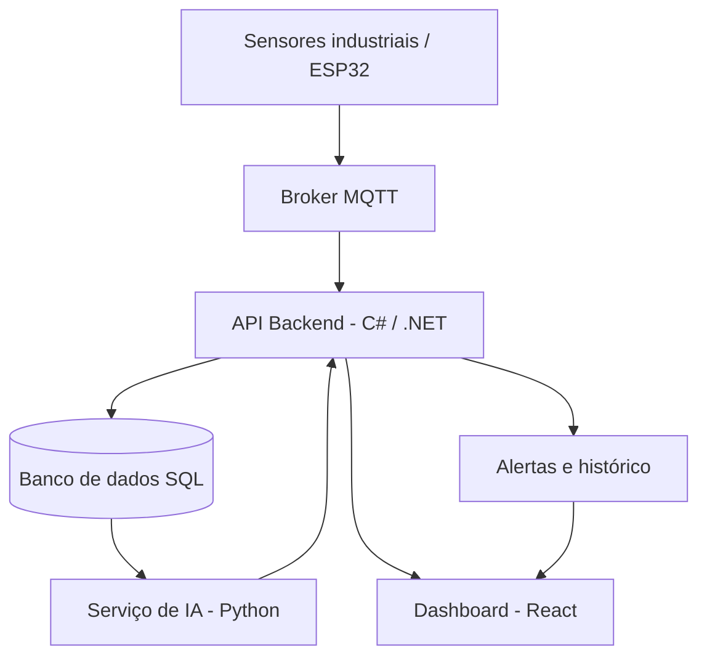

# industrial-iot-platform
Industrial IoT monitoring platform with .NET, React, MQTT and AI-based anomaly detection.

# Industrial IoT Platform

**Plataforma inteligente para monitoramento de equipamentos industriais usando IoT, desenvolvimento web e Inteligência Artificial.**

O Industrial IoT Platform é um projeto de portfólio desenvolvido com o objetivo de integrar conceitos de desenvolvimento de software, bancos de dados, comunicação entre dispositivos, computação em nuvem e análise inteligente de dados.

A plataforma permitirá monitorar equipamentos industriais, acompanhar medições de sensores, visualizar históricos e gerar alertas para possíveis condições anormais de funcionamento.

> **Status:** Em desenvolvimento — projeto construído incrementalmente como parte de um plano de estudos de 24 semanas.

## Objetivos do projeto

- Desenvolver uma API REST utilizando C# e ASP.NET Core.
- Modelar e implementar um banco de dados relacional.
- Criar uma interface web com React e TypeScript.
- Simular e integrar dispositivos IoT usando MQTT.
- Implementar monitoramento, histórico de medições e alertas.
- Aplicar técnicas de Inteligência Artificial para detectar possíveis anomalias.
- Automatizar testes, integração e publicação da aplicação.
- Documentar decisões técnicas e boas práticas de desenvolvimento.

## Arquitetura planejada



A arquitetura será implementada por etapas. Inicialmente, o desenvolvimento será concentrado no backend e no modelo de dados. A integração com dispositivos físicos, a nuvem e a Inteligência Artificial será adicionada posteriormente.

## Tecnologias planejadas

| Área | Tecnologias |
|---|---|
| Backend | C#, ASP.NET Core, Entity Framework Core |
| Banco de dados | SQL Server ou PostgreSQL |
| Frontend | React, TypeScript, HTML e CSS |
| IoT | ESP32, sensores e MQTT |
| Inteligência Artificial | Python, pandas e scikit-learn |
| Testes | xUnit e testes de integração |
| DevOps | Git, GitHub Actions, Docker |
| Cloud | Azure ou AWS |
| Documentação de API | Swagger / OpenAPI |

*As tecnologias e integrações serão incorporadas gradualmente durante o desenvolvimento.*

## Funcionalidades planejadas

- [ ] Cadastro e gerenciamento de equipamentos.
- [ ] Cadastro de sensores vinculados aos equipamentos.
- [ ] Coleta e armazenamento de medições.
- [ ] Consulta do histórico de medições.
- [ ] Dashboard com indicadores e gráficos.
- [ ] Sistema de alertas por limites configurados.
- [ ] Comunicação com dispositivos via MQTT.
- [ ] Autenticação e controle de acesso.
- [ ] Detecção de anomalias com técnicas de IA.
- [ ] Execução local com Docker.
- [ ] Pipeline automatizado de testes.
- [ ] Publicação em ambiente de nuvem.

## Estrutura do projeto

```text
industrial-iot-platform/
├── backend/
│   └── IndustrialIoT.sln
├── frontend/
├── ai-service/
├── iot/
│   └── simulator/
├── database/
│   ├── scripts/
│   └── diagrams/
├── docs/
│   ├── requirements.md
│   ├── architecture.md
│   └── database.md
├── tests/
├── .gitignore
├── README.md
└── LICENSE
```

As pastas serão preenchidas conforme cada etapa for desenvolvida. Não é necessário criar todos os projetos e arquivos agora.

## Plano de desenvolvimento

| Etapa | Entrega |
|---|---|
| 1. Fundamentos | Requisitos, organização do repositório e primeiros testes em C# |
| 2. Banco de dados | Entidades, relacionamentos, consultas e migrations |
| 3. Backend | API REST, regras de negócio e documentação |
| 4. Qualidade e segurança | Testes automatizados, validações e autenticação |
| 5. Frontend | Dashboard, gráficos, filtros e integração com a API |
| 6. Cloud e DevOps | Docker, pipeline CI/CD e publicação |
| 7. IoT | Simulador de sensores, MQTT e ingestão de dados |
| 8. Inteligência Artificial | Análise de dados e detecção de anomalias |
| 9. Portfólio | Documentação final, demonstração e melhorias |

## Como executar

As instruções de instalação e execução serão adicionadas conforme os componentes do projeto forem implementados.

Inicialmente, o desenvolvimento começará pela modelagem dos requisitos e pela criação da solução em C#.

## Princípios do projeto

- Código organizado e de fácil manutenção.
- Separação de responsabilidades.
- Validação de dados e tratamento de erros.
- Testes automatizados desde as primeiras funcionalidades.
- Documentação clara e versionamento com Git.
- Evolução incremental, com entregas pequenas e verificáveis.

**Observação:** esta plataforma é um projeto educacional e de portfólio. Os alertas e modelos de IA têm finalidade de monitoramento e apoio à análise, não substituindo sistemas industriais certificados de segurança.

---

Desenvolvido como projeto de estudo e portfólio em desenvolvimento de software, IoT, Cloud e Inteligência Artificial.